# 05 · Performance

"빠르게 보이고, 바로 반응하고, 뒤로 가기가 즉시 되는" 화면을 숫자로 재고 직접 바꿔 봐요. LCP·INP·CLS, bfcache, Speculation Rules와 함께, 긴 작업을 쪼개는 `scheduler.yield()`, 무거운 일을 메인 스레드 밖으로 옮기는 Web Worker, Shared Worker, ArrayBuffer·SharedArrayBuffer, Transferable objects를 다뤄요. 마지막으로 서버가 만들던 이력서 PDF를 브라우저에서 만들어 봐요.

```sh
# 숫자를 정확하게 보려면 빌드한 결과로 확인해요.
pnpm --filter 05-performance build
pnpm --filter 05-performance preview   # https://localhost:5105

# 코드를 고치면서 볼 때는
pnpm --filter 05-performance dev
```

## 결론부터 말할게요

- **Core Web Vitals(LCP·INP·CLS)는 공고 상세부터 재 볼 만해요.** 검색으로 처음 들어오는 사람이 많은 페이지라 첫인상이 이 숫자로 드러나요. 이미 RUM 도구를 쓰고 있다면 그 값을, 없다면 Next.js의 `useReportWebVitals`로 모으는 게 가장 가까운 길이에요.
- **bfcache는 막는 원인부터 없애 볼 만해요.** 따로 만들 기능은 없어요. 외부 페이지로 나갔다가 뒤로 돌아올 때 공고 화면이 기다림 없이 나와요.
- **Speculation Rules는 Next.js 화면 이동에는 필요 없어요.** 다음 "문서"를 미리 그리는 기능인데, Next.js는 문서를 새로 불러오지 않고 화면을 바꿔요.
- **`scheduler.yield()`는 긴 작업을 찾으면 먼저 꺼내 써요.** 워커로 옮기지 않고 `await` 한 줄로 긴 작업을 쪼개서, 그 사이에 클릭을 받아요. 사파리는 지원하지 않아서 `setTimeout`으로 대신해요.
- **Web Worker는 계산 때문에 화면이 멈출 때 써요.** 지원자 목록 파일 만들기, 업로드 전 이미지 줄이기처럼 무거운 계산을 옮기면 그동안에도 화면이 바로 반응해요. 다만 원티드 화면이 느린 이유는 대부분 React 렌더링이라, 워커로 못 옮기는 경우가 더 많아요.
- **Transferable은 워커에 큰 데이터를 넘길 때 같이 써요.** postMessage에 한 줄만 더하면, 100MB도 복사 없이 넘어가요.
- **Shared Worker는 나중에 다시 봐요.** 탭들이 워커 하나를 같이 써서 연결을 모을 수 있지만, 크롬 안드로이드가 148(2026년)부터라 지금은 `04`의 Web Locks 리더 탭이 더 넓게 돼요.
- **이력서 PDF는 브라우저에서도 만들 수 있지만, PDF 서버 비용이 문제가 될 때 다시 봐요.** 워커가 그리면 91KB·6쪽 PDF를 0.2~0.6초에 만들고 화면도 안 멈춰요. 대신 처음 한 번 글꼴 3.2MB와 라이브러리 330KB(gzip)를 받아야 하고, 레이아웃을 따로 다시 그려야 해요. 받을 게 없어야 한다면 브라우저 인쇄(`window.print()`)가 가장 싸요.
- **SharedArrayBuffer는 필요 없어요.** 여러 스레드가 함께 계산할 일이 없고, 켜려면 소셜 로그인 팝업과 외부 리소스를 막을 수 있는 헤더(COOP·COEP)를 붙여야 해요. ArrayBuffer는 파일을 다룰 때 이미 쓰는 기본기예요.

## 한눈에 보기

| 기술 | 원티드에 필요할까요? | 이유 |
| --- | --- | --- |
| Core Web Vitals (LCP·INP·CLS) | ✅ 공고 상세부터 재 볼 만해요 | 실제 사용자 값을 모아야 어디부터 고칠지 정할 수 있어요 |
| bfcache | ✅ 막는 원인부터 없애 볼 만해요 | 뒤로·앞으로 이동이 생각보다 많고, 고칠 것만 고치면 돼요 |
| Speculation Rules | ❌ Next.js 화면 이동에는 필요 없어요 | Next.js `<Link>`는 문서를 새로 불러오지 않아요 |
| `scheduler.yield()` | ➕ 긴 작업을 찾으면 먼저 꺼내 써요 | 워커로 못 옮기는 일도 쪼개고, 다른 일에 순서를 덜 뺏겨요 |
| Web Worker | ➕ 계산 때문에 화면이 멈출 때 써요 | 계산은 옮길 수 있지만, React 렌더링은 못 옮겨요 |
| Transferable objects | ➕ 워커에 큰 데이터를 넘길 때 같이 써요 | 복사하는 시간과 두 배로 드는 메모리를 없애요 |
| 워커 + ArrayBuffer + Transferable | ➕ 브라우저에서 큰 파일을 만들 때 써요 | 지원자 목록 내려받기 같은 일을 멈춤 없이 해요. 아주 크면 서버에서 만들어요 |
| Shared Worker | ⏸ 지금은 Web Locks 리더 탭이 더 넓게 돼요 | 크롬 안드로이드가 148부터 지원해요 |
| 브라우저에서 이력서 PDF 만들기 | ⏸ PDF 서버 비용이 문제가 될 때 다시 봐요 | 만들 수는 있어요. 처음 받을 글꼴이 크고, 서버와 레이아웃을 둘 다 고쳐 가야 해요 |
| SharedArrayBuffer | ❌ 필요 없어요 | 함께 계산할 일이 없고, 켜는 헤더가 로그인 팝업과 외부 리소스를 막아요 |

## 어디서 동작하나요?

[MDN 호환성 데이터](https://github.com/mdn/browser-compat-data)(2026-11-02) 기준이에요. 숫자는 처음 지원한 버전이에요.

| 기술 | 크롬·엣지 데스크톱 | 크롬 안드로이드 | 사파리 macOS | 사파리 iOS | 파이어폭스 |
| --- | --- | --- | --- | --- | --- |
| LCP (`largest-contentful-paint`) | 77+ | 77+ | 26.2+ | 26.2+ | 122+ |
| INP (`event` · `interactionId`) | 96+ | 96+ | 26.2+ | 26.2+ | 144+ |
| CLS (`layout-shift`) | 77+ | 77+ | ❌ | ❌ | ❌ |
| bfcache로 돌아왔는지 (`pageshow` · `persisted`) | 4+ | 18+ | 5+ | 4+ | 11+ |
| 막힌 이유 (`notRestoredReasons`) | 125+ | 125+ | ❌ | ❌ | ❌ |
| 미리 받아 두기 (`prefetch`) | 110+ | 103+ | 🚩 26.2 | 🚩 26.2 | ❌ |
| 미리 그려 두기 (`prerender`) | 105+ | 103+ | ❌ | ❌ | ❌ |
| 미리 그렸는지 확인 (`document.prerendering`) | 108+ | 108+ | ❌ | ❌ | ❌ |
| `scheduler.yield()` | 129+ | 129+ | ❌ | ❌ | 142+ |
| `scheduler.postTask()` | 94+ | 94+ | ❌ | ❌ | 142+ |
| Long Animation Frames | 123+ | 123+ | ❌ | ❌ | ❌ |
| Web Worker | 2+ | 18+ | 4+ | 5+ | 3.5+ |
| 모듈 워커 (`type: 'module'`) | 80+ | 80+ | 15+ | 15+ | 114+ |
| Shared Worker | 5+ | 148+ | 16+ | 16+ | 29+ |
| ArrayBuffer | 7+ | 18+ | 5.1+ | 4.2+ | 4+ |
| SharedArrayBuffer | 68+ | 89+ | 15.2+ | 15.2+ | 79+ |
| Atomics | 68+ | 89+ | 15.2+ | 15.2+ | 78+ |
| 격리됐는지 (`crossOriginIsolated`) | 87+ | 87+ | 15.2+ | 15.2+ | 72+ |
| `COEP: credentialless` | 96+ | 96+ | ❌ | ❌ | 119+ |
| `structuredClone` (transfer 옵션) | 98+ | 98+ | 15.4+ | 15.4+ | 94+ |
| `ArrayBuffer.transfer()` | 114+ | 114+ | 17.4+ | 17.4+ | 122+ |
| OffscreenCanvas 옮기기 | 69+ | 69+ | 16.4+ | 16.4+ | 105+ |
| ReadableStream 옮기기 | 87+ | 87+ | 27+ | 27+ | 103+ |
| TextEncoder | 38+ | 38+ | 10.1+ | 10.3+ | 18+ |
| Cache Storage | 43+ | 43+ | 11.1+ | 11.3+ | 41+ |
| 인쇄 쪽 크기 (`@page size`) | 15+ | 18+ | 18.2+ | 18.2+ | 95+ |
| 인쇄가 끝났는지 (`afterprint`) | 63+ | 63+ | 13+ | 13+ | 6+ |
| Blob 주소 (`URL.createObjectURL`) | 19+ | 25+ | 6+ | 6+ | 19+ |

- CLS는 크롬 계열에서만 잴 수 있어요. 사파리는 26.2부터 LCP와 INP를 잴 수 있어요.
- 🚩 사파리는 설정에서 켜야 해요. 파이어폭스는 미리보기 버전에서만 prefetch를 해볼 수 있어요.
- 어떤 페이지를 bfcache에 얼려 둘지는 브라우저마다 조금씩 달라요. 크롬에서 막힌 이유를 고치면 다른 브라우저에서도 대부분 같이 나아져요.
- 사파리는 `scheduler` 자체가 없어요. 있으면 쓰고 없으면 `setTimeout`으로 쉬는 함수를 같이 둬요.
- postMessage로 ArrayBuffer를 옮기는 건 오래전부터 모든 주요 브라우저가 지원해요.
- Shared Worker는 사파리가 6.1에서 뺐다가 16에서 다시 넣었고, 크롬 안드로이드는 148부터예요.
- SharedArrayBuffer는 `crossOriginIsolated`일 때만 쓸 수 있어요. 외부 리소스를 덜 막는 `COEP: credentialless`는 사파리가 지원하지 않아서, 사파리까지 격리하려면 `require-corp`를 써야 해요.

## 직접 해보기

첫 화면에서 기능을 고르면, 화면마다 할 일이 하나씩 나와요.

| 기술 | 코드 | 해보는 방법 |
| --- | --- | --- |
| Core Web Vitals | `src/vitals.ts`, `src/web-vitals.tsx` | 웹 성능 점수 재기 → "느리게 반응하는 버튼 누르기" → 0.3초 멈춘 만큼 INP가, 조금 뒤 끼어든 배너만큼 CLS가 올라가요 |
| bfcache | `src/bfcache.tsx`, `other.html` | 뒤로 가기를 바로 보여주기 → "다른 페이지에 갔다가 돌아오기" → "원래 화면으로 돌아가기" → "이 화면을 연 시각"이 그대로면 얼려 둔 화면을 꺼낸 거예요 |
| Speculation Rules | `src/speculation.tsx`, `other.html`, `src/other.ts` | 다음 페이지 미리 그려 두기 → 몇 초 기다렸다가 "미리 그린 페이지로 이동하기" → 이동한 페이지가 미리 그려 뒀는지(`activationStart`) 알려줘요 |
| `scheduler.yield()` | `src/yield.tsx`, `src/primes.ts` | 긴 작업을 쪼개서 숨 쉴 틈 주기 → "한 번에", "setTimeout", "yield"를 차례로 해 보기 → 다 끝난 시간, 가장 긴 멈춤, 끼어든 다른 일을 비교해요. 세는 동안 화면을 누르면 클릭이 기다린 시간도 재요 |
| Web Worker | `src/web-worker.tsx`, `src/workers/prime.ts`, `src/primes.ts` | 무거운 계산을 워커로 옮기기 → "화면에서 소수 세기" → 파란 점이 멈춰요 → "워커에서 소수 세기" → 점이 계속 움직여요 |
| Transferable | `src/transfer.tsx`, `src/workers/receive.ts` | 큰 데이터를 복사 없이 넘기기 → "100MB 복사해서 보내기" → "100MB 옮겨서 보내기" → 걸린 시간과 이 탭에 남은 크기를 비교해요 |
| 실무 예제 | `src/applicant-export.tsx`, `src/workers/export.ts` | 지원자 10만 명 멈춤 없이 내려받기 → "지원자 10만 명 내려받기" → CSV 파일이 내려받아지고, 그동안 화면이 멈추지 않았는지 보여줘요 |
| Shared Worker | `src/shared-worker.tsx`, `src/workers/notify.ts` | 탭들이 워커 하나 같이 쓰기 → "이 화면을 새 탭으로 열기"로 탭을 두세 개 열기 → 아무 탭에서 "지금 알림 확인하기" → 모든 탭 숫자가 같이 바뀌어요 |
| 이력서 PDF | `src/resume-pdf.tsx`, `src/workers/resume-pdf.ts`, `src/resume-document.tsx`, `src/resume.ts` | 이력서 PDF를 브라우저에서 만들기 → "이력서 PDF 내려받기" → 6쪽 PDF가 내려받아져요. 한 번 더 누르면 글꼴을 Cache Storage에서 꺼내요 → "인쇄 창으로 저장"으로 바꾸고 "인쇄 창 열기" → "PDF로 저장" |
| SharedArrayBuffer | `src/shared-memory.tsx`, `src/workers/counter.ts` | 워커끼리 메모리 같이 쓰기 → "그냥 더해 보기" → 숫자가 사라져요 → "Atomics로 더해 보기" → 정확해요 |

- bfcache와 Speculation Rules는 다른 문서로 이동해야 보여서, 두 번째 페이지(`other.html`)를 같이 빌드해요(`vite.config.ts`의 `build.rolldownOptions.input`).
- 미리 그리기가 안 되고 "평범하게 불러온 페이지"라고 나오면 DevTools를 닫고 다시 해봐요. DevTools나 자동화 도구가 붙어 있으면 브라우저가 미리 그리지 않을 수 있어요.
- SharedArrayBuffer를 쓰려고 dev와 preview 서버 모두 COOP·COEP 헤더를 붙여요(`vite.config.ts`의 `isolation`). 이 샘플은 다른 출처의 파일을 불러오지 않아서 다른 화면에는 영향이 없어요. 헤더를 붙인 뒤에도 bfcache 복원과 미리 그리기(prerender)가 그대로 되는 걸 확인했어요.
- 이력서 PDF 화면만 `pdf-lib`, `fontkit`, `pretendard`를 써요. 셋 다 워커와 인쇄할 때만 불러서, 첫 화면 번들에는 들어가지 않아요.
- 워커에서만 쓰는 `pdf-lib`·`fontkit`은 `vite.config.ts`의 `optimizeDeps.include`에 적어 뒀어요. 안 그러면 dev 서버가 버튼을 누를 때 처음 찾고, 페이지를 새로 고쳐요.
- 워커 화면의 파란 점은 일부러 JavaScript(`requestAnimationFrame`)로 움직여요. CSS 애니메이션은 메인 스레드가 바빠도 움직일 수 있어서, 멈춘 걸 보여주지 못해요.

## LCP·INP·CLS를 쉽게 말하면

구글이 "사용자가 느끼는 빠르기"를 세 숫자로 정리한 게 Core Web Vitals예요. 실제 사용자 값을 모아서 **75번째 백분위**로, 모바일과 데스크톱을 나눠서 봐요.

| 지표 | 쉽게 말하면 | 좋아요 | 나빠요 |
| --- | --- | --- | --- |
| LCP · 첫 화면이 보이기까지 | 가장 큰 이미지나 글 덩어리가 그려진 시각. 식당에서 메인 요리가 나오기까지 | 2.5초 이하 | 4초 초과 |
| INP · 눌렀을 때 반응하기까지 | 클릭·탭·키 입력부터 바뀐 화면이 보이기까지 걸린 시간 중 가장 느린 값 | 200ms 이하 | 500ms 초과 |
| CLS · 화면이 흔들린 정도 | 읽던 글이 갑자기 밀려서 엉뚱한 걸 누르게 되는 경험을 숫자로 만든 것 | 0.1 이하 | 0.25 초과 |

- **LCP**는 사용자가 누르거나 스크롤하면 그 뒤로는 더 재지 않아요.
- **INP**는 세 가지 시간을 더해요. 브라우저가 다른 일을 하느라 클릭을 바로 못 받은 시간, 클릭 처리 코드가 돈 시간, 처리가 끝나고 바뀐 화면이 나오기까지의 시간이에요. 마우스를 올리거나 스크롤하는 건 세지 않아요.
- **CLS**는 1초 안에 이어진 흔들림을 한 묶음(최대 5초)으로 더하고, 가장 큰 묶음의 점수를 써요. 내가 누른 직후 0.5초 안의 움직임은 예상한 것이라 빼요. 그래서 이 샘플은 배너를 누른 즉시가 아니라 0.8초 뒤에 끼워 넣어요.

## bfcache를 쉽게 말하면

페이지를 떠날 때 브라우저가 그 페이지를 **통째로 얼려 뒀다가**, 뒤로 가기를 누르면 그대로 꺼내 주는 기능이에요. 처음부터 다시 받지 않으니 기다림이 없어요. 크롬 사용 데이터로는 데스크톱 이동 10번 중 1번, 모바일 5번 중 1번이 뒤로·앞으로 가기예요.

이런 게 있으면 얼려 두지 못해요.

- **`unload` 이벤트**: 쓰지 않아요. 떠날 때 할 일은 `pagehide`로 옮겨요.
- **`Cache-Control: no-store`**: 로그인한 페이지와 Next.js가 SSR한 페이지에 붙어요. 크롬은 그래도 얼려 두지만, 떠난 사이 쿠키가 바뀌면(로그인·로그아웃) 버리고 다시 불러와요. 다른 브라우저는 얼려 두지 않을 수 있어요.
- **열려 있는 연결**: WebSocket·WebRTC, 진행 중인 `fetch`나 IndexedDB 작업이 있으면 브라우저에 따라 얼려 두지 않아요.
- **`window.opener`**: 다른 창이 이 페이지를 붙잡고 있으면 안전하게 얼릴 수 없어요.

크롬은 막힌 이유를 `notRestoredReasons`로 알려줘요. DevTools → Application → Back/forward cache에서 직접 시험해 볼 수도 있어요.

### Next.js에서는 문서가 바뀔 때만 일해요

따로 짤 코드는 없어요. 공고 목록은 브라우저에서 API로 받고(`useEffect`), 공고 상세는 서버에서 그리는(SSR) Next.js 16 앱을 만들어 `build` 후 `start`로 띄우고 크롬 157에서 돌려 봤어요.

| 이렇게 움직이면 | bfcache | 돌아왔을 때 |
| --- | --- | --- |
| 목록 → `<Link>`로 상세 → 뒤로 | 아니에요 | 문서가 그대로라 Next.js가 목록을 다시 그려요. '불러오는 중'이 보이고 API를 다시 불러요. 그동안 페이지가 짧아져서 보던 스크롤 위치도 잃어요 |
| 목록 → 외부 페이지 → 뒤로 | ✅ | 받아 둔 목록이 그대로예요. API를 다시 부르지 않아요 |
| 상세로 바로 들어옴 → 외부 페이지 → 뒤로 | ✅ | 서버에서 그린 화면이 그대로예요. `no-store`가 붙어 있어도 꺼내요 |
| 위와 같은데 떠난 사이 쿠키가 바뀜 | ❌ | 다시 불러와요. 로그아웃한 뒤 뒤로 가기로 개인정보가 보이지 않아요 |
| `next dev`에서 목록 → 외부 페이지 → 뒤로 | ❌ | 개발 서버가 붙이는 `no-store`와 WebSocket 연결 때문에 다시 불러와요 |

- Next.js는 동적으로 SSR한 페이지에 `Cache-Control: private, no-cache, no-store, max-age=0, must-revalidate`를 붙여요. 크롬은 이 헤더가 있어도 쿠키가 그대로면 얼려 둬요.
- 앱 안에서 뒤로 갈 때 목록을 보던 자리 그대로 보여주고 싶다면 bfcache가 아니라 받아 둔 데이터로 바로 그리면 돼요. TanStack Query에 `staleTime`과 `gcTime`을 주니 '불러오는 중' 없이 그려져서, 크롬이 스크롤 위치까지 되돌려 놨어요. API도 다시 부르지 않았어요.
- Next.js 16의 `cacheComponents`도 상세에 있는 동안 목록을 지우지 않고 숨겨 뒀다가, 돌아오면 '불러오는 중' 없이 바로 보여줬어요. 다만 `useEffect`가 다시 돌아서 API는 한 번 더 불러요.
- 얼려 둔 화면은 떠날 때 값 그대로예요. 낙관적 업데이트로 켠 좋아요도 남지만, 떠난 사이 다른 탭에서 바뀐 값은 몰라요. `pageshow`의 `persisted`가 `true`일 때 그런 값만 다시 받아요.
- 사파리와 파이어폭스는 확인하지 않았어요.
- 직접 보려면 [`05-performance-next.js`](../05-performance-next.js)를 빌드해서 띄워요.

## Speculation Rules를 쉽게 말하면

사용자가 누를 것 같은 다음 페이지를 **미리 준비**해 두는 규칙이에요. HTML에 JSON 몇 줄만 넣으면 브라우저가 알아서 해요.

```html
<script type="speculationrules">
{ "prerender": [{ "urls": ["/other.html?from=speculation"] }] }
</script>
```

- **prefetch(미리 받아 두기)**: 다음 페이지의 HTML만 받아 둬요. 그리지는 않아요.
- **prerender(미리 그려 두기)**: 보이지 않는 탭에서 페이지를 통째로 그려 둬요. 이동하면 바로 바꿔 끼워서 기다림이 없어요.
- **언제 준비할지(eagerness)**: `immediate`는 규칙을 보자마자, `eager`·`moderate`는 링크에 마우스를 올리면, `conservative`는 누르기 시작할 때 준비해요. 주소 목록(`urls`) 규칙은 `immediate`, 문서 안 링크 규칙은 `conservative`가 기본값이에요.
- **조심할 것**: 데이터와 메모리를 더 써요. 미리 그리는 동안에도 페이지 코드가 돌아서, 분석 도구가 페이지뷰를 먼저 세지 않게 `document.prerendering`을 보고 실제로 보여진 뒤에 보내야 해요. 데이터 절약 모드, 배터리 절약 모드, 메모리가 부족할 때는 브라우저가 준비하지 않아요.

## scheduler.yield()를 쉽게 말하면

긴 작업 중간에 **"잠깐 쉴게요"** 하고 메인 스레드를 내주는 함수예요. 쉬는 동안 브라우저는 화면을 그리고 클릭을 처리하고, 그다음 내 일을 이어서 해요. 화면을 만지는 일처럼 워커로 옮길 수 없는 일도 쪼갤 수 있어요.

```js
// 1. 긴 반복을 쪼개요
for (const applicant of applicants) {
  score(applicant)
  await scheduler.yield()   // 잠깐 쉬었다가 이어서 해요
}

// 2. 클릭하면 화면 먼저, 무거운 일은 나중에
button.addEventListener('click', async () => {
  showSpinner()             // 사용자가 바로 볼 반응
  await scheduler.yield()   // 여기서 바뀐 화면이 그려져요
  saveAndSendLogs()         // 무거운 뒷일
})
```

React에서도 같아요. `setState`로 화면을 먼저 바꾸고 `await scheduler.yield()` 뒤에 무거운 일을 하면, 바뀐 화면이 먼저 그려져요.

### setTimeout으로 쉬는 것과 뭐가 달라요?

- **`setTimeout(0)`**은 내 다음 조각을 줄 **맨 뒤**에 세워요. 그사이 광고·분석 스크립트 같은 다른 일이 먼저 돌아서, 다 끝나는 시간이 늘어나요.
- **`scheduler.yield()`**는 내 다음 조각을 같은 우선순위 줄의 **맨 앞**에 세워요. 화면 그리기와 클릭은 끼어들 수 있지만, 다른 일반 작업보다 내 일이 먼저 이어져요.
- 대신 크롬은 내 일이 이어지는 동안 **화면 그리기를 조금 미뤄요.** 그래서 매끄러운 애니메이션보다 클릭 반응(INP)과 빨리 끝내는 게 중요한 일에 맞아요.

샘플 화면에서 500만까지 소수를 세면서, 16ms마다 8ms씩 메인 스레드를 쓰는 "다른 스크립트"를 같이 돌려 재 봤어요(Apple M3 Pro 맥, 크롬 헤드리스, 실제 마우스 클릭을 3번 보냄).

| 방법 | 다 끝난 시간 | 가장 긴 프레임 간격 | 클릭이 기다린 시간 | 다른 스크립트가 끼어든 횟수 |
| --- | --- | --- | --- | --- |
| 한 번에 | 739ms | 741ms | 288~589ms | 0번 |
| `setTimeout`으로 쪼개기 | 1,663ms | 26ms | 1~4ms | 103번 |
| `scheduler.yield()`로 쪼개기 | 742ms | 102ms | 0~6ms | 0번 |

### 얼마나 자주 쉬어요?

긴 작업 기준인 50ms를 넘기 전에 쉬어요. 반복할 때마다 쉬면 쉬는 비용이 쌓이니까, 시간으로 끊는 게 좋아요.

```js
let deadline = performance.now() + 50
for (const item of items) {
  process(item)
  if (performance.now() > deadline) {
    await yieldToMain()
    deadline = performance.now() + 50
  }
}
```

### 사파리에서는 setTimeout으로 대신해요

```js
function yieldToMain() {
  if (globalThis.scheduler?.yield) return scheduler.yield()
  // 사파리: setTimeout으로 쉬어요. 대신 줄 맨 뒤에 서요.
  return new Promise((resolve) => setTimeout(resolve, 0))
}
```

### Web Worker와 언제 나눠 써요?

- **화면(DOM)을 만지거나 React 상태를 바꾸는 일**은 워커로 못 옮겨요. `scheduler.yield()`로 쪼개요.
- **화면과 상관없는 오래 걸리는 계산**은 워커로 옮겨요. 쪼개도 메인 스레드가 하는 일의 총량은 그대로예요.
- React 렌더링 자체는 `startTransition`이 알아서 쪼개요. `scheduler.yield()`는 내가 쓴 코드(이벤트 핸들러, 데이터 가공)에 써요.

## 워커와 메모리를 쉽게 말하면

### Web Worker: 뒤에서 일하는 일꾼을 하나 더 둬요

탭에는 화면을 그리고 클릭을 받는 일꾼이 **하나(메인 스레드)**뿐이에요. 이 일꾼이 오래 걸리는 계산을 하면, 그동안 클릭도 스크롤도 애니메이션도 멈춰요. Web Worker는 뒤에서 따로 일하는 일꾼을 하나 더 두는 거예요.

```js
// 화면: 워커를 만들고 일을 보내요.
const worker = new Worker(new URL('./prime-worker.js', import.meta.url), { type: 'module' })
worker.postMessage({ limit: 5_000_000 })
worker.onmessage = (event) => showResult(event.data.count)

// prime-worker.js: 이 파일은 워커에서 돌아요.
self.onmessage = (event) => {
  const count = countPrimes(event.data.limit) // 오래 걸려도 화면은 멀쩡해요
  self.postMessage({ count })
}
```

- **못 하는 것:** 화면(document, window, React 렌더링)을 못 만져요. localStorage도 못 써요. fetch, IndexedDB, 타이머, WebSocket은 돼요.
- **주고받는 데이터는 복사돼요.** 몇 MB가 넘는 바이너리는 Transferable로 옮겨요.
- **이럴 때 써요:** 업로드 전 이미지 줄이기(OffscreenCanvas), 큰 CSV·엑셀 만들기와 읽기, 수천 개가 넘는 목록 검색·정렬, 압축·암호화·코드 하이라이트처럼 라이브러리가 오래 도는 일이에요.
- **먼저 확인해요:** INP가 나쁜데 원인이 React 렌더링이라면 워커로는 못 고쳐요. DevTools Performance 패널에서 긴 작업이 계산 때문인지 먼저 봐요. 렌더링 때문이면 `startTransition`, 긴 목록 가상화, 작업 쪼개기(`scheduler.yield()`)를 봐요.
- 워커를 띄우는 데도 수십 ms가 들어서, 금방 끝나는 일은 메인 스레드에서 하는 게 빨라요. 다 쓴 워커는 `terminate()`로 닫아요. postMessage가 번거로우면 [Comlink](https://github.com/GoogleChromeLabs/comlink) 같은 작은 라이브러리로 함수 부르듯 써요.

### Shared Worker: 탭 여러 개가 워커 하나를 같이 써요

보통 워커(Dedicated Worker)는 만든 탭 하나만 써요. Shared Worker는 **같은 주소, 같은 이름**이면 탭 여러 개가 워커 하나에 붙어요. 마지막 탭이 닫히면 워커도 사라져요.

```js
// notify-worker.js: 탭들이 붙을 때마다 onconnect가 불려요.
const ports = new Set()
self.onconnect = (event) => {
  const port = event.ports[0]
  ports.add(port)
  port.onmessage = () => checkNotifications()
}

async function checkNotifications() {
  const data = await (await fetch('/api/notifications')).json()
  ports.forEach((port) => port.postMessage(data)) // 모든 탭에 나눠 줘요
}

// 탭: 같은 주소, 같은 이름이면 같은 워커에 붙어요.
const worker = new SharedWorker(new URL('./notify-worker.js', import.meta.url), { name: 'notify' })
worker.port.onmessage = (event) => showBadge(event.data)
```

- **`04`의 Web Locks 리더 탭과 비교하면:** Shared Worker는 연결과 상태가 워커 안에 있어서, 탭 하나가 닫혀도 연결이 끊기지 않아요. 리더 탭 방식은 리더가 닫히면 다음 탭이 이어받아 다시 연결하지만, 2022년부터 모든 주요 브라우저에서 돼요.
- 탭이 닫혀도 워커가 바로 알 방법이 없어서, 떠날 때(`pagehide`) "나 가요"를 직접 보내요.
- 워커의 로그는 탭의 DevTools에 안 보여요. 크롬에서 `chrome://inspect/#workers`를 열어 따로 봐요.
- 배포하면 새 탭은 새 워커에, 열려 있던 탭은 옛 워커에 붙어서, 잠깐 둘이 같이 돌아요.

### ArrayBuffer: 바이트를 담는 메모리예요

ArrayBuffer는 **바이트(0~255 숫자)를 담는, 크기가 정해진 메모리**예요. 파일, 이미지, 네트워크로 받은 바이너리가 모두 ArrayBuffer로 와요. 직접 읽고 쓸 수는 없고, `Uint8Array`(1바이트씩), `Int32Array`(4바이트 정수) 같은 창(TypedArray)을 씌워서 봐요.

```js
const buffer = await file.arrayBuffer()   // 파일을 바이트로 읽어요
const bytes = new Uint8Array(buffer)       // 1바이트씩 보는 창을 씌워요
String.fromCharCode(...bytes.slice(0, 4))  // '%PDF'면 진짜 PDF예요
new TextDecoder('euc-kr').decode(bytes)    // 엑셀에서 저장한 CSV를 글자로 바꿔요
```

올린 이력서가 진짜 PDF인지 앞 4바이트로 확인하거나, CSV가 UTF-8인지 EUC-KR인지 가려 읽거나, 업로드 전에 파일 해시(`crypto.subtle.digest`)를 구할 때 써요.

### SharedArrayBuffer: 여러 워커가 같은 메모리를 봐요

워커에 넘길 때 셋이 달라요.



| 넘기는 방법 | 무슨 일이 일어나요? |
| --- | --- |
| ArrayBuffer를 그냥 보내기 | 복사돼요. 100MB면 100MB를 한 번 더 만들어요 |
| ArrayBuffer를 transfer로 옮기기 | 복사 없이 주인만 바뀌고, 보낸 쪽은 비어요 |
| SharedArrayBuffer 보내기 | 복사도 옮기기도 아니에요. 양쪽이 같은 메모리를 동시에 봐요 |

같이 쓰면 숫자가 사라질 수 있어요. 워커 A와 B가 동시에 5를 읽고, 둘 다 1을 더해 6을 쓰면, 두 번 더했는데 한 번이 사라져요. 그래서 `Atomics`로 고쳐요. `Atomics.add`·`load`·`store`는 한 번에 끝나서 끼어들 틈이 없고, `wait`·`notify`로 서로 기다리고 깨울 수도 있어요.

```js
const memory = new SharedArrayBuffer(4)
worker.postMessage(memory) // 복사가 아니라, 같은 메모리를 같이 봐요

// 워커 안
const view = new Int32Array(memory)
view[0]++                 // ❌ 읽고, 더하고, 쓰는 사이에 다른 워커가 끼어들어요
Atomics.add(view, 0, 1)   // ✅ 셋을 한 번에 해서 끼어들 틈이 없어요
```

2018년 Spectre라는 CPU 보안 문제가 알려진 뒤, 브라우저는 SharedArrayBuffer를 막았어요. 지금은 페이지가 다른 출처와 격리됐을 때(`crossOriginIsolated`)만 쓸 수 있어요.

```
Cross-Origin-Opener-Policy: same-origin
Cross-Origin-Embedder-Policy: require-corp
```

- 다른 출처의 이미지, 스크립트, iframe은 CORP나 CORS 헤더가 있어야 불러와요. 유튜브, 광고, 지도, 외부 CDN 이미지가 막힐 수 있어요.
- COOP가 `same-origin`이면 다른 출처 창과 `window.opener`로 주고받는 흐름이 끊겨요. **소셜 로그인 팝업**이 대표적이에요.
- 그래서 브라우저 안 영상 편집(ffmpeg.wasm), 게임과 3D, SQLite 같은 WASM 프로그램을 여러 스레드로 돌릴 때처럼, 대가를 치를 만한 곳에서만 써요.

### Transferable objects: 복사하지 않고 주인을 넘겨요

워커와 주고받는 데이터는 기본으로 **복사**돼요(구조화된 복제, structured clone). Transferable은 복사하는 대신 **주인을 넘겨요**. 넘긴 쪽은 그 데이터를 더 쓸 수 없어요.

```js
const buffer = new ArrayBuffer(100 * 1024 * 1024)

worker.postMessage({ buffer })            // 복사해요. 100MB를 한 번 더 만들어요
worker.postMessage({ buffer }, [buffer])  // 옮겨요. 두 번째 칸이 "옮길 목록"이에요
buffer.byteLength                         // 0. 이제 워커 거예요

// 워커에서 돌려줄 때도 같아요
self.postMessage({ result }, [result.buffer])
```

- **옮길 수 있는 것:** ArrayBuffer(TypedArray는 `.buffer`를 옮겨요), MessagePort, ImageBitmap, OffscreenCanvas, ReadableStream·WritableStream, VideoFrame·AudioData예요.
- **File과 Blob은 옮길 필요가 없어요.** 넘겨도 내용이 아니라 가리키는 정보만 넘어가서 원래 빨라요. 업로드할 파일은 그냥 넘기고, 워커 안에서 `arrayBuffer()`로 읽어요.
- **조심할 것:** 옮긴 뒤 원래 변수를 쓰면 빈 버퍼라 조용히 틀린 값이 나와요. `subarray`로 만든 작은 `Uint8Array`도 `.buffer`를 옮기면 원래 큰 버퍼 전체가 넘어가서, 필요한 부분만 `slice`로 잘라 옮겨요. 작은 JSON은 그냥 복사해도 충분히 빨라요.

이 샘플에서 100MB를 보내면, 워커가 받기까지 복사는 11~14ms, 옮기기는 0.2~0.4ms 걸렸어요(Apple M3 Pro 맥, 크롬 헤드리스).

### 실무 예제: 지원자 10만 명을 멈춤 없이 내려받기

셋은 따로가 아니라 한 줄로 이어져요. **워커**가 무거운 일을 하고, 결과를 **ArrayBuffer**(바이트)로 만들고, **transfer**로 복사 없이 화면에 돌려줘요.

1. 화면이 워커에 "지원자 10만 명 CSV로 만들어 줘"라고 보내요. 숫자 하나라 복사해도 괜찮아요.
2. 워커가 CSV 글자를 만들면서, 1만 명마다 진행률을 보내요.
3. 다 만들면 `TextEncoder`로 바이트(ArrayBuffer)로 바꾸고, transfer로 옮겨요. 13MB를 복사하지 않아요.
4. 화면은 받은 ArrayBuffer로 Blob을 만들어 바로 내려받아요. 글자로 다시 바꾸지 않아요.

```js
// export-worker.js: 무거운 일은 전부 여기서 해요.
self.onmessage = async ({ data }) => {
  const applicants = await loadApplicants(data.count) // fetch로 페이지마다 불러요
  const csv = applicants.map(toCsvRow).join('\r\n')
  const bytes = new TextEncoder().encode('\uFEFF' + csv) // 글자 → 바이트(ArrayBuffer)
  self.postMessage({ buffer: bytes.buffer }, [bytes.buffer]) // 복사하지 않고 옮겨요
}

// 화면: 받은 바이트로 파일을 만들어 바로 내려받아요.
worker.onmessage = ({ data }) => {
  const url = URL.createObjectURL(new Blob([data.buffer], { type: 'text/csv' }))
  Object.assign(document.createElement('a'), { href: url, download: '지원자.csv' }).click()
}
```

엑셀에서 안 깨지고 안전하게 열리게 하려면 세 가지를 챙겨요.

- **맨 앞에 BOM(`\uFEFF`)을 붙여요.** 없으면 엑셀이 UTF-8 파일을 다른 인코딩으로 읽어서 한글이 깨져요.
- **지원자가 쓴 글이 수식으로 실행되지 않게 막아요.** `=`, `+`, `-`, `@`로 시작하는 칸은 엑셀이 수식으로 실행해요([CSV 인젝션](https://owasp.org/www-community/attacks/CSV_Injection)). 앞에 `'`를 붙여요. 이 샘플의 3번 지원자가 그 예예요.
- **쉼표, 따옴표, 줄바꿈이 섞인 칸은 따옴표로 감싸요.** 안의 따옴표는 두 번 써요.

```js
function cell(value) {
  const safe = /^[=+\-@]/.test(value) ? `'${value}` : value
  return /[",\r\n]/.test(safe) ? `"${safe.replaceAll('"', '""')}"` : safe
}
```

실제 서비스로 옮길 때는 워커가 지원자 API를 직접 불러요(같은 출처면 로그인 쿠키도 같이 가요). 엑셀(XLSX)이 필요하면 [SheetJS](https://docs.sheetjs.com/docs/demos/bigdata/worker) 같은 라이브러리를 워커 안에서 써요. 수십만 행을 넘으면 브라우저 메모리가 모자랄 수 있어서, 그때는 서버에서 만들어 내려주는 게 나아요. 반대로 올린 CSV를 `file.arrayBuffer()`로 읽어 워커에 옮기고, 워커가 인코딩(UTF-8·EUC-KR)을 가려 읽는 것도 같은 방법이에요.

## 이력서 PDF를 브라우저에서 만들 수 있을까요?

만들 수 있어요. 지금 원티드 서버는 **크롬(Chromium)으로 이력서 HTML을 PDF로 인쇄**해요. 서버가 만든 PDF 안에 `Creator: Chromium`, `Producer: Skia/PDF m133`이 남아 있고, 글꼴은 Noto Sans KR 500·700이에요. 브라우저에서는 두 가지 방법이 있어요. 이 샘플은 붙여 주신 이력서 JSON을 같은 모양 그대로 써요(`src/resume.ts`, 내부 번호·키는 빼고 휴대폰 번호는 가짜로 바꿨어요).

### 방법 1 · 워커가 PDF를 직접 그려요

1. 화면이 이력서 JSON을 워커에 보내요. 작아서 복사해도 괜찮아요.
2. 워커가 글꼴을 준비해요. 처음엔 받고, 다음부터는 Cache Storage에 담아 둔 걸 써요.
3. [pdf-lib](https://pdf-lib.js.org)로 글자를 그리고 쪽을 나눠요. 글꼴은 이력서에 쓴 글자만 골라 담아서(subset) PDF가 작아요.
4. 다 만든 PDF 바이트(ArrayBuffer)를 transfer로 옮기고, 화면은 Blob으로 바로 내려받아요.

```js
// resume-pdf-worker.js
import { PDFDocument } from 'pdf-lib'

self.onmessage = async ({ data }) => {
  const doc = await PDFDocument.create()
  doc.registerFontkit(fontkit)
  const font = await doc.embedFont(await loadFont(), { subset: true }) // 쓴 글자만 담아요
  const page = doc.addPage([595.28, 841.89]) // A4
  page.drawText(data.resume.name, { x: 38, y: 790, size: 18, font })
  // … 줄바꿈과 쪽 나누기를 직접 계산하며 그려요
  const bytes = await doc.save()
  self.postMessage({ buffer: bytes.buffer }, [bytes.buffer]) // 복사하지 않고 옮겨요
}
```

### 방법 2 · 브라우저 인쇄 기능을 써요

인쇄용 CSS를 붙이고 `window.print()`를 불러요. 크롬이면 서버와 **같은 엔진(Skia)**으로 PDF를 만들어요. 받을 라이브러리도, 새로 그릴 레이아웃도 없어요. 대신 인쇄 창에서 "PDF로 저장"을 한 번 골라야 하고, 브라우저마다 결과가 조금 달라요.

```css
@media print {
  @page { size: A4; margin: 15mm 13mm; }
  .no-print { display: none; }
  .project-title { break-after: avoid; }  /* 제목만 쪽 끝에 남지 않게 */
  .education { break-before: page; }      /* 새 쪽에서 시작 */
}
```

`window.print()` 전에 `document.title`을 바꾸면, 그게 저장할 PDF의 기본 파일 이름이 돼요(`afterprint`에서 되돌려요).

### 재 본 결과

Apple M3 Pro 맥, 크롬 헤드리스에서 같은 이력서로 재 봤어요.

| | 서버 (지금) | 방법 1 · 워커 | 방법 2 · 인쇄 |
| --- | --- | --- | --- |
| PDF 크기 | 589KB | 91KB | 68KB (`Page.printToPDF`) |
| 쪽 수 | 6쪽 | 6쪽 | 6쪽 |
| 만드는 시간 | 서버 몫 | 0.2~0.6초 (워커) | 브라우저 인쇄 |
| 처음 받는 것 | 없음 | 글꼴 3.2MB + 라이브러리 330KB(gzip) | 웹 글꼴 1.5MB(WOFF2) |
| 두 번째부터 | 없음 | 글꼴은 Cache Storage에서 4ms | 브라우저 캐시 |
| 화면 멈춤 | 없음 | 없음 (가장 긴 프레임 20ms) | 인쇄 창이 떠요 |

### 만들며 부딪힌 것

- **처음 받을 게 많아요.** Pretendard 굵기 하나가 OTF로 1.6MB예요. 더 작은 WOFF2(0.76MB)는 fontkit이 subset하지 못해서 못 써요.
- **옛 fontkit은 글자가 비어 보여요.** pdf-lib가 쓰는 `@pdf-lib/fontkit`(2022년 이후 멈춤)은 subset한 글자 일부가 PDF에서 비어 보여요. 고쳐진 [fontkit 2](https://github.com/foliojs/fontkit)를 쓰고, pdf-lib가 부르는 `encodeStream()` 모양으로 감쌌어요(`src/workers/resume-pdf.ts`).
- **글꼴이 글자를 바꿔요.** Pretendard는 `->`를 화살표(→)로 바꾸는 합자 기능(`calt`, `clig`)이 있어요. 그대로 두면 이력서 내용이 바뀌어서, PDF는 `features`로, 인쇄용 화면은 `font-variant-ligatures: none`으로 꺼요.
- **로고를 담을 수 없어요.** 회사·학교 로고(`static.wanted.co.kr`)는 CORS 헤더가 없어서, 브라우저에서는 PDF에 담을 수 없어요. 그래서 첫 글자를 넣은 상자로 그렸어요. 서버는 담을 수 있어요.
- **레이아웃을 직접 계산해요.** HTML·CSS가 없어서 줄바꿈(한글은 글자 사이, 영어는 단어 단위), 쪽 나누기, 여백을 좌표로 계산해요. 서버 PDF와 똑같이 맞추려면 손이 많이 가요.

### 원티드에 옮긴다면

- 기업에 제출되는 이력서 PDF는 누가 열어도 같아야 해서 **서버에 둬요.** "내가 내려받는 내 이력서"만 브라우저로 옮겨요.
- 화면을 열 때 워커와 글꼴을 미리 받아 두면, 버튼을 누른 뒤에는 그리기만 해서 더 빨라요.
- 글꼴은 brotli로 압축해 내려주면 1.6MB가 0.8MB쯤으로 줄어요. 해시가 붙은 파일에 긴 `Cache-Control`을 주면 브라우저 캐시도 Cache Storage와 같은 일을 해요.
- 받을 게 하나도 없어야 한다면 방법 2(인쇄)가 가장 싸요. 이미 있는 이력서 화면에 인쇄용 CSS만 더하면 돼요.

## 기술별로 자세히

### Core Web Vitals · ✅ 공고 상세부터 재 볼 만해요

- **무엇인가요:** `PerformanceObserver`로 `largest-contentful-paint`, `event`, `layout-shift` 기록을 받아서 LCP·INP·CLS를 계산해요. 이 샘플은 직접 계산하지만, 실제 서비스라면 web-vitals 라이브러리나 RUM 도구를 써요.
- **문서:** [web.dev · Core Web Vitals](https://web.dev/articles/vitals) · [web.dev · LCP](https://web.dev/articles/lcp) · [web.dev · INP](https://web.dev/articles/inp) · [web.dev · CLS](https://web.dev/articles/cls) · [Google 검색 센터 · Core Web Vitals](https://developers.google.com/search/docs/appearance/core-web-vitals) · [Next.js · useReportWebVitals](https://nextjs.org/docs/app/api-reference/functions/use-report-web-vitals)
- **기대할 수 있는 것:** 공고 상세는 검색으로 처음 들어오는 사람이 많은 페이지라, 첫인상이 이 세 숫자로 드러나요. 구글도 검색에서 좋은 Core Web Vitals를 갖추라고 강하게 권해요. 실제 사용자 값을 모아야 어디부터 고칠지 정할 수 있어요.
- **한계:** 이 샘플에서 보는 숫자는 내 브라우저 한 번의 값이에요. 실제로는 많은 방문을 모아 75번째 백분위로, 모바일과 데스크톱을 나눠 봐야 해요. CLS는 크롬 계열에서만 잴 수 있어서 사파리 사용자의 흔들림은 보이지 않아요. 이미 RUM 도구를 쓰고 있다면 그 값을 쓰고, 없다면 Next.js의 `useReportWebVitals`로 모으는 게 가장 가까운 길이에요.
- **이렇게 확인해요:** 공고 목록·공고 상세·지원하기처럼 페이지 종류별로, 세 지표의 75번째 백분위를 모바일·데스크톱으로 나눠 보고 나쁜 것부터 고쳐요.

### bfcache · ✅ 막는 원인부터 없애 볼 만해요

- **무엇인가요:** 뒤로·앞으로 갈 때 얼려 둔 페이지를 그대로 꺼내는 브라우저 기능이에요. `pageshow` 이벤트의 `persisted`가 `true`면 bfcache로 돌아온 거예요.
- **문서:** [web.dev · bfcache](https://web.dev/articles/bfcache) · [Chrome for Developers · notRestoredReasons](https://developer.chrome.com/docs/web-platform/bfcache-notrestoredreasons) · [MDN · pageshow 이벤트](https://developer.mozilla.org/docs/Web/API/Window/pageshow_event) · [MDN · notRestoredReasons](https://developer.mozilla.org/docs/Web/API/PerformanceNavigationTiming/notRestoredReasons)
- **기대할 수 있는 것:** 회사 홈페이지나 외부 지원 페이지로 나갔다가 뒤로 돌아올 때, 공고 화면이 기다림 없이 그대로 나와요. 뒤로·앞으로 이동이 생각보다 많아서, 막는 원인만 없애도 효과가 커요.
- **한계:** Next.js 안에서 `<Link>`로 화면을 오가는 건 문서가 그대로라 bfcache와 상관없어요. 외부 페이지로 나갔다가 돌아올 때만 일해요. 크롬은 `Cache-Control: no-store`가 붙은 페이지(로그인한 페이지, Next.js가 SSR한 페이지)도 얼려 두고, 떠난 사이 쿠키가 바뀌면 다시 불러와요. 다른 브라우저까지 노리고 `no-store`를 걷어내려면, 뒤로 가기로 개인정보가 다시 보여도 괜찮은지 먼저 따져야 해요. `next dev`에서는 얼려 두지 않아서 `build` 후 `start`로 확인해요. 막힌 이유를 알려주는 `notRestoredReasons`는 크롬 계열에서만 돼요.
- **이렇게 확인해요:** `notRestoredReasons`를 모아서 가장 많이 나온 원인부터 없애고, `pageshow`의 `persisted`로 bfcache로 돌아온 비율이 늘었는지 봐요.

### Speculation Rules · ❌ Next.js 화면 이동에는 필요 없어요

- **무엇인가요:** `<script type="speculationrules">`에 적은 주소를 브라우저가 미리 받아 두거나(prefetch) 그려 둬요(prerender). 미리 그린 페이지가 보여지면 `activationStart`에 그리기 시작부터 보여진 순간까지의 시간이 남아요.
- **문서:** [MDN · Speculation Rules API](https://developer.mozilla.org/docs/Web/API/Speculation_Rules_API) · [MDN · `<script type="speculationrules">`](https://developer.mozilla.org/docs/Web/HTML/Reference/Elements/script/type/speculationrules) · [Chrome for Developers · 페이지 미리 그리기](https://developer.chrome.com/docs/web-platform/prerender-pages) · [MDN · activationStart](https://developer.mozilla.org/docs/Web/API/PerformanceNavigationTiming/activationStart)
- **필요 없는 이유:** Speculation Rules는 다음 "문서"를 미리 받아 두거나 그려 두는 기능이에요. Next.js의 `<Link>`는 문서를 새로 불러오지 않고 JavaScript로 화면을 바꾸고, 다음 화면 데이터도 이미 미리 받아 둬요. 그래서 원티드 안의 화면 이동에는 끼어들 자리가 없어요.
- **다시 볼 때:** 서로 다른 앱을 오가는 것처럼 문서를 새로 불러오는 이동이 잦은 곳이 생기면 다시 봐요. 그때도 미리 그린 페이지가 페이지뷰를 먼저 세지 않게 실제로 보여진 뒤에 보내야 하고, 크롬 계열에서만 동작해요.

### scheduler.yield() · ➕ 긴 작업을 찾으면 먼저 꺼내 써요

- **무엇인가요:** `await scheduler.yield()`로 메인 스레드를 잠깐 내주고, 남은 일을 같은 우선순위 줄의 맨 앞에서 이어서 해요. `scheduler.postTask()` 안에서 부르면 그 작업의 우선순위와 취소 신호를 이어받아요.
- **문서:** [MDN · Scheduler.yield()](https://developer.mozilla.org/docs/Web/API/Scheduler/yield) · [MDN · Prioritized Task Scheduling API](https://developer.mozilla.org/docs/Web/API/Prioritized_Task_Scheduling_API) · [Chrome for Developers · scheduler.yield() 쓰기](https://developer.chrome.com/blog/use-scheduler-yield) · [web.dev · 긴 작업 줄이기](https://web.dev/articles/optimize-long-tasks) · [Chrome for Developers · Long Animation Frames](https://developer.chrome.com/docs/web-platform/long-animation-frames)
- **얻을 수 있는 것:** INP를 재서 50ms 넘는 작업을 찾았을 때, 코드를 워커로 옮기지 않고 `await` 한 줄로 쪼갤 수 있어요. 클릭에 대한 반응을 먼저 그리고 무거운 뒷일(저장, 로그 전송)을 미루는 데 특히 좋아요. 화면을 만지는 일처럼 워커로 못 옮기는 일에도 써요.
- **한계:** 사파리는 지원하지 않아서 `setTimeout`으로 대신해야 해요. 그러면 쉬는 동안 다른 일에 순서를 뺏겨 다 끝나는 시간이 늘 수 있어요. 쪼개도 메인 스레드가 하는 일의 총량은 그대로이고, React 렌더링 안에서는 못 써요. 렌더링은 `startTransition`이 대신 쪼개 줘요.
- **이렇게 확인해요:** Long Animation Frames로 어떤 스크립트가 긴 프레임을 만드는지 찾고, 쪼갠 뒤 INP의 75번째 백분위가 줄었는지 봐요.

### Web Worker · ➕ 계산 때문에 화면이 멈출 때 써요

- **무엇인가요:** 메인 스레드와 따로 도는 스크립트예요. `new Worker(url)`로 만들고 `postMessage`로 메시지만 주고받아요.
- **문서:** [MDN · Web Worker 쓰기](https://developer.mozilla.org/docs/Web/API/Web_Workers_API/Using_web_workers) · [web.dev · 메인 스레드 밖에서 JavaScript 돌리기](https://web.dev/articles/off-main-thread) · [web.dev · 긴 작업 줄이기](https://web.dev/articles/optimize-long-tasks) · [Vite · Web Workers](https://vite.dev/guide/features#web-workers) · [GitHub · Comlink](https://github.com/GoogleChromeLabs/comlink)
- **얻을 수 있는 것:** 기업 대시보드에서 지원자 목록을 파일로 만들거나, 프로필 사진을 올리기 전에 줄이는 것처럼 계산이 무거운 일을 워커로 옮기면, 그동안에도 화면이 클릭과 스크롤에 바로 반응해요(INP).
- **한계:** 원티드 화면이 느린 이유는 대부분 계산보다 React 렌더링과 네트워크예요. 렌더링은 워커로 옮길 수 없어요. 워커는 화면(DOM)을 못 만지고, 주고받는 데이터는 복사돼요.
- **이렇게 확인해요:** DevTools Performance 패널이나 Long Animation Frames로 50ms 넘는 작업을 찾고, 그게 계산 때문인지 먼저 봐요. 렌더링 때문이면 워커 대신 `startTransition`이나 작업 쪼개기를 봐요.

### Transferable objects · ➕ 워커에 큰 데이터를 넘길 때 같이 써요

- **무엇인가요:** `postMessage(data, [옮길 것])`처럼 옮길 목록을 주면, 복사하지 않고 주인을 넘기는 방식이에요. 넘긴 쪽의 ArrayBuffer는 비어요(`byteLength` 0).
- **문서:** [MDN · Transferable objects](https://developer.mozilla.org/docs/Web/API/Web_Workers_API/Transferable_objects) · [MDN · 구조화된 복제](https://developer.mozilla.org/docs/Web/API/Web_Workers_API/Structured_clone_algorithm) · [MDN · ArrayBuffer.prototype.transfer()](https://developer.mozilla.org/docs/Web/JavaScript/Reference/Global_Objects/ArrayBuffer/transfer) · [Chrome for Developers · Transferable objects](https://developer.chrome.com/blog/transferable-objects-lightning-fast)
- **얻을 수 있는 것:** 이미지나 파일처럼 몇 MB가 넘는 바이너리를 워커와 주고받을 때, 복사하는 동안 메인 스레드가 묶이는 시간과 두 배로 드는 메모리를 없애요. postMessage에 한 줄만 더하면 돼요.
- **한계:** 워커를 쓸 때만 의미가 있어요. 넘긴 쪽은 그 데이터를 더 쓸 수 없어요. 작은 JSON은 복사해도 충분히 빨라요.

### 워커 + ArrayBuffer + Transferable · ➕ 브라우저에서 큰 파일을 만들 때 써요

- **무엇인가요:** 워커가 파일 내용을 만들고, `TextEncoder`로 바이트(ArrayBuffer)로 바꿔, transfer로 화면에 옮기는 흐름이에요. 화면은 받은 바이트로 Blob을 만들어 내려받아요.
- **문서:** [MDN · Web Worker 쓰기](https://developer.mozilla.org/docs/Web/API/Web_Workers_API/Using_web_workers) · [MDN · Transferable objects](https://developer.mozilla.org/docs/Web/API/Web_Workers_API/Transferable_objects) · [MDN · TextEncoder](https://developer.mozilla.org/docs/Web/API/TextEncoder) · [OWASP · CSV 인젝션](https://owasp.org/www-community/attacks/CSV_Injection) · [SheetJS · 워커에서 엑셀 만들기](https://docs.sheetjs.com/docs/demos/bigdata/worker)
- **얻을 수 있는 것:** 지원자 목록 내려받기처럼 브라우저에서 큰 파일을 만들면, 만드는 동안 화면이 멈추고 버튼을 눌러도 반응이 없어요. 워커로 옮기면 진행률을 보여주면서 다른 일도 계속할 수 있어요.
- **한계:** 파일을 이미 서버에서 만들어 내려주고 있다면 필요 없어요. 수십만 행을 넘으면 브라우저 메모리가 모자랄 수 있어서, 그때는 서버에서 만드는 게 나아요.
- **이렇게 확인해요:** 내려받기 버튼을 누른 뒤 화면이 멈춘 시간(Long Animation Frame)과, 그동안 다른 클릭의 INP를 재요.

### Shared Worker · ⏸ 지금은 Web Locks 리더 탭이 더 넓게 돼요

- **무엇인가요:** 같은 출처의 탭들이 함께 쓰는 워커예요. 탭마다 `port`가 하나씩 생기고, 워커는 붙은 port를 모아 같은 결과를 보내요.
- **문서:** [MDN · SharedWorker](https://developer.mozilla.org/docs/Web/API/SharedWorker) · [MDN · Web Worker 쓰기 (Shared worker)](https://developer.mozilla.org/docs/Web/API/Web_Workers_API/Using_web_workers) · [MDN · Web Locks API](https://developer.mozilla.org/docs/Web/API/Web_Locks_API)
- **얻을 수 있는 것:** 탭마다 따로 여는 알림 폴링이나 실시간 연결을 워커 하나로 모을 수 있어요. 누가 리더인지 정할 필요 없이, 연결과 상태가 워커 안에 남아요.
- **한계:** 크롬 안드로이드는 148(2026년)부터 지원해서, 아직 옛 버전을 쓰는 안드로이드 사용자는 못 써요. 같은 일은 `04`의 Web Locks 리더 탭과 BroadcastChannel로 모든 주요 브라우저에서 할 수 있어요. 워커 로그가 탭 DevTools에 안 보여서 디버깅도 번거로워요.
- **다시 볼 때:** 크롬 안드로이드 148 이상 사용자가 대부분이 되고, 탭마다 여는 연결이 실제로 서버에 부담이 될 때 다시 봐요.

### 브라우저에서 이력서 PDF 만들기 · ⏸ PDF 서버 비용이 문제가 될 때 다시 봐요

- **무엇인가요:** 서버의 크롬이 하던 "이력서 HTML → PDF"를 사용자 브라우저에서 해요. 워커에서 pdf-lib로 직접 그려 바로 내려받거나, 브라우저 인쇄(`window.print()`)로 저장해요.
- **문서:** [pdf-lib](https://pdf-lib.js.org) · [GitHub · fontkit](https://github.com/foliojs/fontkit) · [GitHub · Pretendard (OFL)](https://github.com/orioncactus/pretendard) · [MDN · window.print()](https://developer.mozilla.org/docs/Web/API/Window/print) · [MDN · @page](https://developer.mozilla.org/docs/Web/CSS/@page) · [MDN · CacheStorage](https://developer.mozilla.org/docs/Web/API/CacheStorage)
- **얻을 수 있는 것:** 서버의 크롬 없이 사용자 기기에서 PDF를 만들어서, PDF를 만드는 서버 비용과 기다리는 시간을 없앨 수 있어요. 워커가 그리니 만드는 동안 화면도 멈추지 않고, 글꼴을 한 번 받아 두면 다음부터는 그리기만 해요.
- **한계:** 처음 한 번 한글 글꼴 3.2MB(brotli로 줄이면 1.6MB쯤)와 PDF 라이브러리(gzip 330KB)를 받아야 해요. 레이아웃을 HTML·CSS 대신 좌표로 다시 그려서, 서버 PDF와 똑같이 맞추고 둘 다 고쳐 가는 비용이 생겨요. 회사·학교 로고 같은 다른 출처 이미지는 CORS 헤더가 없으면 담지 못해요. 인쇄 기능(`window.print`)은 받을 게 없지만 인쇄 창을 한 번 거쳐야 해요.
- **이렇게 확인해요:** 서버의 PDF 생성 요청 수와 건당 시간·비용을 먼저 보고, 저사양 안드로이드 기기에서 브라우저로 만드는 시간을 재서 비교해요.
- **다시 볼 때:** PDF 서버가 비용이나 대기열 문제를 일으킬 때, "내가 내려받는 내 이력서"부터 옮겨 봐요. 기업에 제출되는 PDF는 누가 열어도 같아야 해서 서버에 둬요.

### SharedArrayBuffer · ❌ 필요 없어요

- **무엇인가요:** 여러 워커가 복사 없이 같이 보는 메모리예요. 동시에 고치면 값이 사라져서 `Atomics`로 고쳐요. 페이지가 `crossOriginIsolated`일 때만 쓸 수 있어요.
- **문서:** [MDN · ArrayBuffer](https://developer.mozilla.org/docs/Web/JavaScript/Reference/Global_Objects/ArrayBuffer) · [MDN · SharedArrayBuffer](https://developer.mozilla.org/docs/Web/JavaScript/Reference/Global_Objects/SharedArrayBuffer) · [MDN · Atomics](https://developer.mozilla.org/docs/Web/JavaScript/Reference/Global_Objects/Atomics) · [MDN · crossOriginIsolated](https://developer.mozilla.org/docs/Web/API/Window/crossOriginIsolated) · [web.dev · COOP와 COEP로 격리하기](https://web.dev/articles/coop-coep)
- **필요 없는 이유:** ArrayBuffer는 파일과 이미지를 다룰 때 이미 쓰는 기본기라 따로 들일 게 없어요. SharedArrayBuffer는 영상 편집이나 WASM 멀티스레드처럼 여러 스레드가 큰 메모리를 함께 계산할 때 써요. 원티드에는 그런 계산이 없고, 워커에 큰 데이터를 넘기는 건 Transferable로 충분해요.
- **한계:** 쓰려면 사이트 전체에 COOP·COEP 헤더를 붙여야 해요. 그러면 소셜 로그인 팝업처럼 다른 출처 창과 주고받는 흐름이 끊기고, CORP·CORS 헤더가 없는 외부 이미지·iframe이 막혀요.
- **다시 볼 때:** 브라우저 안에서 영상이나 큰 데이터를 여러 스레드로 처리해야 할 때 다시 봐요. 그때도 헤더가 로그인과 외부 리소스를 막지 않는지 먼저 확인해요.

## 알아두면 좋은 것

- INP는 브라우저가 실제 입력으로 인정하는 클릭(trusted event)만 재요. 개발자 도구 콘솔에서 `button.click()`을 불러도 INP는 바뀌지 않아요.
- 이 샘플의 INP는 상호작용 중 가장 느린 값이에요. 원래 정의는 상호작용이 50번을 넘으면 50번마다 가장 느린 1개를 빼요.
- 아이콘 파일이 없으면 브라우저가 `/favicon.ico`를 요청해서 404가 나요. 그래서 두 페이지 모두 `<link rel="icon" href="data:,">`로 빈 아이콘을 둬요.
- 화면은 [Tailwind CSS](https://tailwindcss.com) v4로 만들었어요. 화면 틀과 판단 화면은 `02`·`03`과 같이 `../shared/`를 써요.
- "원티드에 필요할까요?", "어디서 동작하나요?", 참고 문서는 앱의 기능 화면 맨 아래에도 있어요. 내용은 `src/report.tsx`에 모여 있으니, 고칠 때 이 README와 함께 고쳐요.
