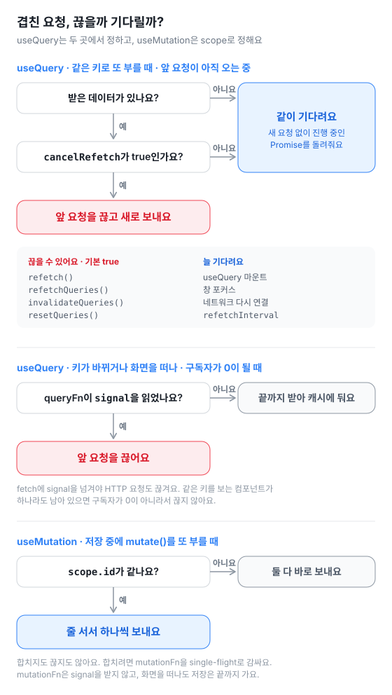
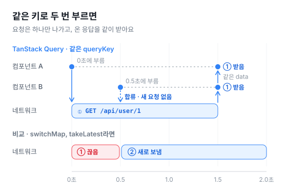
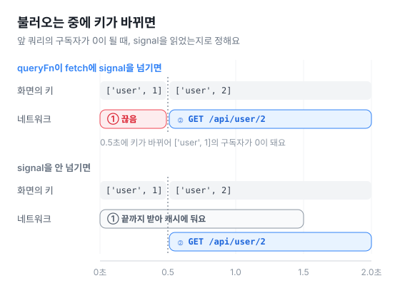
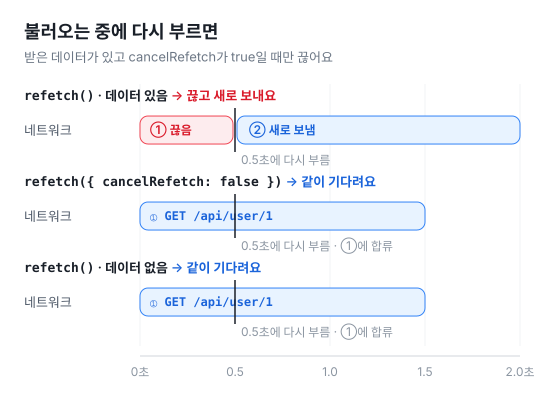
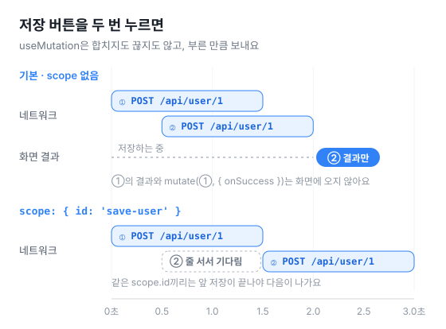
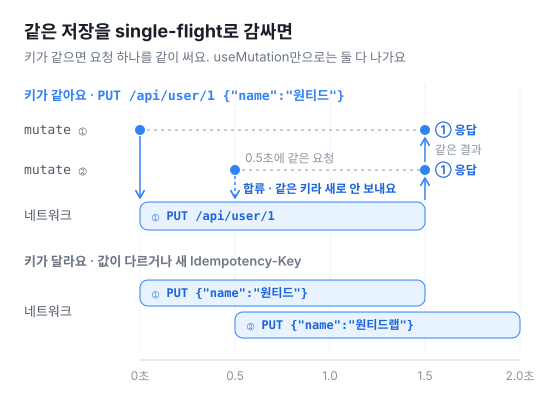
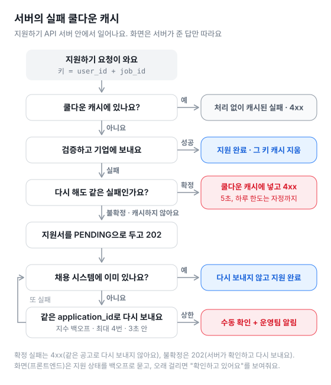

# 07 · Concurrency control

TanStack Query에서 같은 요청이 겹치면 어떻게 되는지 직접 세어 봐요. useQuery로 읽을 때와 useMutation으로 저장할 때를 모두 봐요. 진짜 HTTP 요청을 보내서, 몇 번 나가고 언제 끊기는지 네트워크 기록으로 보여줘요.

저장(POST·PUT·PATCH·DELETE)을 single-flight로 한 번만 보내는 방법과, 실패한 요청을 다시 처리하지 않게 하는 **실패 쿨다운 캐시**도 같이 있어요.

```sh
pnpm --filter 07-concurrency-control dev     # https://localhost:5107
pnpm --filter 07-concurrency-control proof   # 화면 없이 30가지 경우를 확인해요
```

`@tanstack/react-query` 5.107.1 기준이에요.

## 결론부터 말할게요

- **useQuery는 같은 queryKey로 진행 중인 요청이 있으면, 끊지도 새로 보내지도 않고 같이 기다려요.** 컴포넌트 A가 `['user', 1]`을 부르고 0.5초 뒤에 B가 같은 키로 불러도 HTTP 요청은 한 번만 나가요. 둘 다 같은 응답을 받아요.
- **키가 바뀌면 앞 요청을 끊어요. 단, 두 가지가 다 맞을 때만이에요.** 앞 쿼리를 보는 구독자가 0이 되고, queryFn이 `signal`을 읽었을 때예요. signal을 쓰지 않으면 앞 요청은 끝까지 받아서 캐시에 둬요.
- **`refetch()`는 옵션 없이도 앞 요청을 끊어요.** `cancelRefetch` 기본값이 `true`라서요. 기다리게 하려면 `cancelRefetch: false`를 적어요.
- **아직 받은 데이터가 없으면 `cancelRefetch: true`여도 끊지 않고 기다려요.**
- **마운트, 창 포커스, 네트워크 다시 연결, `refetchInterval`은 진행 중인 요청을 기다려요.**
- **useMutation은 합치지도 끊지도 않아요.** `mutate()`를 두 번 부르면 저장 요청이 두 번 다 바로 나가요. `scope.id`가 같을 때만 줄을 서서 하나씩 나가요.
- **useMutation은 마지막 저장만 보여줘요.** `save.data`와 `mutate(vars, { onSuccess })`로 넘긴 콜백은 마지막 것만 받아요. `useMutation({ onSuccess })`는 저장마다 불려요.
- **저장도 한 번만 보내려면 `mutationFn`을 single-flight로 감싸요.** 같은 키로 진행 중인 요청이 있으면 그 Promise를 같이 써요. 키는 PUT·DELETE·값을 정하는 PATCH는 요청 그대로, POST는 누를 때 만든 `Idempotency-Key`로 만들어요. 이 탭 안에서만 막으니, 서버도 `Idempotency-Key`로 막아요.
- **실패 쿨다운 캐시는 서버 쪽 구현이에요.** 원티드 지원하기로 보면, 서버가 다시 해도 같은 실패(마감된 공고, 이미 지원함, 하루 지원 한도)를 잠깐 기억해서 처리 없이 바로 4xx로 돌려줘요. 키는 공고 때문이면 `user_id + job_id`, 사람 때문이면 `user_id`예요. 실제로는 들어갔을 수도 있는 불확정 실패(기업 채용 시스템 타임아웃·5xx)는 서버가 지원서를 PENDING으로 두고, 채용 시스템에 이미 있는지부터 본 뒤 같은 `application_id`로 다시 보내요. 프론트엔드는 서버가 준 답을 따라요. 4xx면 같은 공고로 다시 보내지 않고, 202면 지원 상태를 백오프로 물어봐요.



## 처음 주장과 비교하면

| 주장 | 확인 결과 |
| --- | --- |
| 같은 키로 진행 중일 때 2번 요청이 들어오면, 1번을 끊지도 2번을 새로 보내지도 않아요 | ✅ 맞아요 |
| 2번 요청은 1번의 Promise를 공유받아 같이 기다려요 | ✅ 맞아요. 쿼리가 들고 있는 진행 중인 Promise(`#fetchPromise`)를 돌려줘요. 다만 `fetchQuery()`를 두 번 불러 받은 Promise끼리 `===`로 비교하면 달라요. `query.fetch()`가 `async` 함수라 한 번 감싸서 돌려줘서요. 받은 data는 같은 객체예요 |
| 키가 바뀌고 queryFn에 signal을 연결했으면, 앞 요청이 Abort되고 새 요청이 나가요 | ✅ 맞아요. 같은 키를 보는 다른 컴포넌트가 남아 있으면 끊지 않아요 |
| `refetch({ cancelRefetch: true })`를 부르면 앞 요청을 끊고 새로 시작해요 | ⚠️ 맞지만, 옵션을 적지 않아도 기본이 `true`예요. 그리고 이미 받은 데이터가 있을 때만 끊어요 |
| 자동 마운트·포커스 리패치는 기존 요청을 기다려요 | ✅ 맞아요. 내부에서 `cancelRefetch` 없이(포커스는 `false`로) 불러요 |
| 같은 키에 대한 동시 요청이면 네트워크 요청은 단 1번만 나가요 | ⚠️ useQuery가 알아서 부를 때는 맞아요. 진행 중에 직접 `refetch()`·`invalidateQueries()`를 부르면, 데이터가 있을 때 앞 요청을 끊고 한 번 더 나가요. useMutation은 합치지 않아서 부른 만큼 나가요 |

## 직접 해보기

첫 화면에서 하나를 고르면, 화면마다 버튼이 하나씩 있어요. 가짜 API는 1.5초 늦게 답해요. DevTools Network 탭을 같이 열어 두면 끊긴 요청은 `(canceled)`로 보여요.

| 화면 | 코드 | 해보는 방법 | 이렇게 보여요 |
| --- | --- | --- | --- |
| 같은 키로 두 번 부르기 | `src/single-flight.tsx` | "컴포넌트 두 개 띄우기" → A가 `['user', 1]`을 부르고, 0.5초 뒤 B가 같은 키로 불러요 | 보냄① → 받음①. A와 B 모두 ① 응답이에요 |
| 불러오는 중에 키 바꾸기 | `src/key-change.tsx` | "1번을 불러오다 2번으로 바꾸기" → 0.5초 뒤 키가 `['user', 2]`로 바뀌어요 | 보냄① → 끊음① → 보냄② → 받음② |
| 〃 (signal 스위치를 끄고) | 〃 | 같은 버튼을 다시 눌러요 | 보냄① → 보냄② → 받음① → 받음②. ①은 캐시에 남아요 |
| 불러오는 중에 다시 부르기 · `refetch()` | `src/cancel-refetch.tsx` | "불러오는 중에 한 번 더 부르기" → 0.5초 뒤 `refetch()` | 보냄① → 끊음① → 보냄② → 받음② |
| 〃 · `refetch({ cancelRefetch: false })` | 〃 | 두 번째 부름을 바꾸고 다시 눌러요 | 보냄① → 받음① |
| 〃 · 데이터가 없을 때 `refetch()` | 〃 | `resetQueries()`로 비우고 불러오는 중에 `refetch()` | 보냄① → 받음① |
| 저장 버튼 두 번 누르기 | `src/mutation.tsx` | "저장하기 두 번 누르기" → 0.5초 뒤 한 번 더 `mutate()` | 보냄① → 보냄② → 받음① → 받음②. 화면 결과와 `mutate`의 onSuccess는 ②만, `useMutation`의 onSuccess는 ①② 두 번 |
| 〃 (scope 스위치를 켜고) | 〃 | 같은 버튼을 다시 눌러요 | 보냄① → 받음① → 보냄② → 받음②. ②는 ①이 끝난 뒤에 나가요 |
| 같은 저장은 한 번만 보내기 | `src/mutation-single-flight.tsx`, `src/dedupe.ts` | 메서드를 고르고 "PUT 두 번 보내기" → 0.5초 뒤 같은 요청을 한 번 더 | POST·PUT·PATCH·DELETE 모두 보냄① → 받음①. 두 곳 모두 ① 응답. `useMutation`의 onSuccess는 2번 |
| 〃 ("다른 요청으로 보내기"를 켜고) | 〃 | 두 번째는 값이 다르거나(PUT·PATCH), 다른 주소(DELETE), 새 Idempotency-Key(POST) | 키가 달라서 ①②가 따로 나가요 |
| 서버의 실패 쿨다운 캐시 | `src/failure-cooldown.tsx`, `apply-server.ts` | 실패를 고르고 "지원하기 세 번, 다른 공고 한 번" | 마감된 공고·이미 지원함: ①만 처리하고 ②③은 캐시가 4xx로 답해요. ④ 다른 공고는 캐시를 거치지 않고 지원돼요. 하루 한도: 사람 키라 ④ 다른 공고도 캐시가 답해요(자정까지). 매크로: ① 지원 후 ②③은 429(캐시), 2초 쉰 ④는 지원돼요 |
| 불확정 실패 다시 맞추기 | `src/uncertain-failure.tsx`, `apply-server.ts` | 기업 채용 시스템 상태를 고르고 "지원하기" | 응답만 잃어버림: 202 → 채용 시스템에 이미 있어서 다시 보내지 않고 지원 완료(보낸 횟수 1번). 잠깐 오류: 같은 application_id로 두 번 더 보내서 지원 완료. 계속 오류: 3초 상한을 넘겨 수동 확인 + 운영팀 알림, 화면은 "지원서를 확인하고 있어요". 마감된 공고: 409를 받고 다시 보내지 않아요 |

위 표의 "이렇게 보여요"는 크롬에서 직접 눌러 본 기록이에요. 브라우저 네트워크 이벤트로도 끊긴 요청은 `net::ERR_ABORTED`로 잡혔어요.

### 그림으로 보기

화면마다 설명 맨 위에도 같은 그림이 있어요.













## 화면 없이 확인하기

`proof.ts`는 `QueryClient`, `QueryObserver`, `MutationObserver`와 화면이 쓰는 `src/dedupe.ts`, `apply-server.ts`를 그대로 불러 같은 내용을 확인해요. 가짜 API는 0.1초 뒤에 답하고, 지원하기 서버는 시간을 짧게 줄인 설정으로 띄워요.

```
✓ 같은 키: 진행 중에 들어온 두 번째 구독자는 새 요청 없이 같은 결과를 받아요
✓ 같은 키: 창 포커스 리패치는 진행 중인 요청을 끊지 않고 기다려요
✓ 키가 바뀜 + signal 연결: 앞 요청이 끊기고 새 키로 보내요
✓ 키가 바뀜 + signal 안 씀: 앞 요청은 끝까지 받아서 캐시에 남아요
✓ 키가 바뀜 + signal 연결, 다른 구독자가 남아 있으면: 끊지 않아요
✓ refetch(): 옵션 없이도 cancelRefetch가 true라서, 데이터가 있으면 앞 요청을 끊고 다시 보내요
✓ refetch({ cancelRefetch: false }): 앞 요청을 같이 기다려요
✓ refetch(): 아직 데이터가 없으면 cancelRefetch가 true여도 끊지 않고 기다려요
✓ queryClient.refetchQueries(): 기본이 cancelRefetch: true라서 앞 요청을 끊어요
✓ useMutation: mutate()를 두 번 부르면 합치지 않고 둘 다 바로 보내요
✓ useMutation: 화면 결과와 mutate에 넘긴 콜백은 마지막 것만, useMutation의 onSuccess는 매번 불려요
✓ useMutation: scope.id가 같으면 줄을 서서 하나씩 보내요
✓ useMutation: mutationFn은 signal을 받지 않아서 TanStack Query가 끊을 수 없어요
✓ single-flight: 같은 키로 진행 중이면 한 번만 보내고 결과를 나눠 가져요. 끝나면 다음은 새로 보내요
✓ single-flight: 실패도 같이 받고, 끝나면 지워서 다음은 새로 보내요
✓ single-flight 키: PUT·PATCH·DELETE는 요청 그대로, POST는 Idempotency-Key로 정해요
✓ useMutation + single-flight: 요청은 한 번, 두 mutate가 같은 결과를 받고 useMutation의 onSuccess는 두 번 불려요
✓ 실패 분류: 마감·이력서·한도·중복은 확정, 타임아웃·5xx·모르는 오류는 불확정이에요
✓ 쿨다운 TTL: 하루 지원 한도는 자정까지, 나머지는 설정값만큼이에요
✓ 마감된 공고: 같은 공고는 처음 한 번만 처리하고 나머지는 캐시가 4xx로 바로 답해요. 다른 공고는 캐시를 거치지 않아요
✓ 쿨다운이 지나면 다시 처리해요
✓ 이력서가 없거나 내 것이 아니면 확정 실패예요
✓ 이미 지원한 공고: ALREADY_APPLIED(409)로 답하고, 그다음은 캐시에서 답해요
✓ 하루 지원 한도: 사람 키로 자정까지 캐시해서, 다른 공고도 바로 막아요
✓ 연달아 지원(매크로): 같은 쿨다운 캐시로 막아요. 간격이 지나면 다시 돼요
✓ 불확정(응답만 잃어버림): 202로 답하고 PENDING으로 둬요. 채용 시스템에 있어서 다시 보내지 않고 SUBMITTED
✓ 불확정(채용 시스템 5xx 두 번): 같은 application_id로 다시 보내서 SUBMITTED, 채용 시스템에는 하나만 들어가요
✓ 불확정(채용 시스템이 계속 5xx): 지수 백오프로 상한까지 다시 보내고, 넘기면 수동 확인 + 운영팀 알림
✓ 보내는 중에 같은 지원이 또 오면: 새 지원서를 만들지 않고 보내는 중인 것을 알려줘요
✓ 성공하면 그 키의 쿨다운 캐시를 바로 지워요

30개 모두 예상대로예요.
```

## 라이브러리 코드로 보면

진행 중일 때 다시 부르면 `query.ts`의 `fetch()`가 정해요(줄였어요).

```ts
if (this.state.fetchStatus !== 'idle') {
  if (this.state.data !== undefined && fetchOptions?.cancelRefetch) {
    this.cancel({ silent: true })   // 데이터가 있고 cancelRefetch면 끊고 새로 보내요
  } else if (this.#retryer && this.#fetchPromise) {
    return this.#fetchPromise       // 아니면 진행 중인 Promise를 그대로 돌려줘요
  }
}
```

키가 바뀌거나 컴포넌트가 사라지면 `removeObserver()`가 정해요(줄였어요).

```ts
if (!this.observers.length) {              // 이 쿼리를 보는 구독자가 0이 되면
  if (this.#abortSignalConsumed) {         // queryFn이 signal을 읽었으면
    this.#retryer.cancel({ revert: true }) //   끊어요
  } else {
    this.#retryer.cancelRetry()            //   아니면 끝까지 받아 캐시에 둬요
  }
}
```

`cancelRefetch` 기본값은 부르는 곳마다 달라요.

| 부르는 곳 | 진행 중일 때 |
| --- | --- |
| `refetch()`, `queryClient.refetchQueries()`, `invalidateQueries()`, `resetQueries()` | 데이터가 있으면 끊어요 (기본 `true`) |
| useQuery 마운트, 창 포커스, 네트워크 다시 연결, `refetchInterval` | 기다려요 |

useMutation은 `mutationObserver.ts`의 `mutate()`가 부를 때마다 새 mutation을 만들어요(줄였어요). 키가 없어서 합칠 대상도 없어요.

```ts
mutate(variables, options) {
  this.#mutateOptions = options                 // mutate에 넘긴 콜백은 마지막 것으로 덮어써요
  this.#currentMutation?.removeObserver(this)   // 앞 mutation은 더 지켜보지 않아요
  this.#currentMutation = mutationCache.build(client, this.options) // 늘 새로 만들어요
  this.#currentMutation.addObserver(this)
  return this.#currentMutation.execute(variables)
}
```

줄 세우기는 `mutationCache.ts`의 `canRun()`이 정해요. 같은 `scope.id`에 먼저 진행 중인 mutation이 있으면 기다렸다가, 그게 끝나면 `runNext()`로 다음 것을 이어 보내요. scope가 없으면 늘 바로 보내요.

## 실패 쿨다운 캐시를 원티드 지원하기로 옮기면

### 서버 쪽 구현이에요

실패 쿨다운 캐시는 **서버에서 처리하는 기법**이에요. 프론트엔드가 맡는 건 설계의 2-4뿐이에요.

| 설계 | 어디서 해요 | 왜요 |
| --- | --- | --- |
| 2-1 실패 분류 | 서버 | DB 타임아웃, 채용 시스템 5xx처럼 서버 안에서 나는 실패를 나눠요 |
| 2-2 확정 실패 쿨다운 캐시, 연달아 지원 막기 | 서버 | 같은 요청이 버튼 연타, 앱 재시도, 다른 탭과 기기, 매크로에서 와요. 모든 요청이 지나는 서버가 막아야 해요. 매크로 막기는 클라이언트를 믿을 수 없어서 서버가 해요 |
| 2-3 PENDING, 채용 시스템 재확인, 다시 보내기 | 서버 | 기업 채용 시스템과 이야기하는 건 서버예요 |
| 2-4 백오프 폴링, "확인하고 있어요", 확정 실패면 다시 보내지 않기 | 프론트엔드 | 서버가 준 답(4xx, 202)을 보고 화면이 할 일을 정해요 |

이 샘플은 서버를 Vite에 붙인 가짜 서버(`apply-server.ts`)로 흉내 내고, 화면은 그 서버에 요청만 보내요.

### 광고 보상 설계를 지원하기로 옮기면

처음 설계는 광고를 보고 포인트를 받는 서비스 기준이었어요. 같은 생각을 원티드 "지원하기"에 옮겼어요. 사용자가 지원하기를 누르면 원티드 서버가 지원서를 만들어 기업 채용 시스템에 보내요. 서버는 `apply-server.ts`이고, Vite 서버에 붙어 있어요(dev와 preview 모두).

| 설계 원문 (광고 보상) | 원티드 지원하기 |
| --- | --- |
| 캐시 키 `user_id + ad_session_id` | 공고 때문이면 `user_id + job_id`, 사람 때문이면(하루 한도, 연달아 지원) `user_id` |
| 서명 검증 실패, 세션 없음·만료·소유자 불일치 | 마감된 공고, 이력서 없음, 내 이력서가 아님 |
| 일일 한도 초과 (자정까지) | 하루 지원 한도 초과 (자정까지) |
| 이미 지급됨 | 이미 지원함 |
| 광고 세션 발급 rate limit | 연달아 지원 rate limit(매크로 막기). 지원서를 하나 만들면 2초 동안 막아요 |
| `reward_grants` PENDING, `grant_id` | 지원서 PENDING, `application_id` |
| 포인트 원장(진실의 원천) | 기업 채용 시스템(지원서가 들어갔는지 아는 곳) |
| SSV 콜백: 확정·중복 2xx, 불확정 5xx | 지원하기 API: 확정 4xx(다시 보내지 마세요), 불확정 202(접수했고 서버가 확인해요) |
| 지급 상태 백오프 폴링, "지급 확인 중" | 지원 상태 백오프 폴링, "지원서를 확인하고 있어요" |
| 확정 실패면 같은 ad_session_id로 다시 요청하지 않음 | 확정 실패면 같은 공고로 다시 보내지 않음 |

| 설계 | 코드 (`apply-server.ts`) | 이 샘플의 값 |
| --- | --- | --- |
| 2-1 실패를 확정·불확정으로 나눠요 | `classify()`. 코드마다 왜 그쪽인지 주석을 달았어요. 모르는 오류는 불확정이에요 | — |
| 2-2 확정 실패만 쿨다운 캐시해요 | `CooldownCache`, `cooldownKey()`, `cooldownUntil()`. 지원이 성공하면 `#submitted()`에서 그 키를 지워요 | 5초, 하루 한도는 자정까지 |
| 2-2 연달아 지원 막기 | `apply()`에서 지원서를 만들면 `user:user_id`에 `RATE_LIMITED`를 미리 넣어요 | 2초 |
| 2-3 불확정은 PENDING으로 두고 다시 맞춰요 | `apply()`의 `catch`, `#retryLater()`, `#reconcile()`. 채용 시스템에 이미 있는지 먼저 보고, 없으면 같은 application_id로 다시 보내요 | 0.3초부터 두 배씩, 최대 4번, 3초 안. 넘기면 `MANUAL_REVIEW` + 운영팀 알림 |
| 2-4 화면 쪽 쿨다운 | `src/uncertain-failure.tsx`. 지원 상태를 백오프로 묻고, 끝난 상태를 받거나 최대 대기를 넘기면 멈춰요 | 0.5 → 1 → 2초, 최대 6초 |

API는 모두 쿼리 문자열로 받아요.

| 주소 | 하는 일 |
| --- | --- |
| `POST /api/applications?user_id=&job_id=&resume_id=` | 지원하기 |
| `GET /api/applications/:application_id?user_id=` | 지원 상태 조회. 학습용으로 서버 기록(events)도 같이 내려줘요 |
| `POST /api/lab/scenario?daily_used=&applied=&faults=` | 상태를 비우고 실험을 준비해요. 채용 시스템 장애(`lost`: 들어갔는데 응답 유실, `down`: 5xx)를 차례로 일으켜요 |

## 코드

| 파일 | 하는 일 |
| --- | --- |
| `src/main.tsx` | 첫 화면과 `QueryClientProvider`. 전체 흐름 그림을 보여줘요 |
| `src/requests.tsx` | 진짜 `fetch`로 사용자를 불러오거나 저장하고, 보냄·받음·끊음을 시각과 함께 기록해요 |
| `src/single-flight.tsx` | 같은 키를 부르는 컴포넌트 두 개를 0.5초 차이로 띄워요 |
| `src/key-change.tsx` | 불러오는 중에 키를 바꿔요. signal을 넘길지 스위치로 골라요 |
| `src/cancel-refetch.tsx` | 불러오는 중에 `refetch()`를 한 번 더 불러요 |
| `src/mutation.tsx` | 저장하는 중에 `mutate()`를 한 번 더 불러요. scope를 쓸지 스위치로 골라요 |
| `src/mutation-single-flight.tsx` | POST·PUT·PATCH·DELETE를 single-flight로 감싸서 두 번 보내요. 키를 화면에 보여줘요 |
| `src/dedupe.ts` | `singleFlight()`와 키를 만드는 `flightKey()`. 화면과 `proof.ts`가 같이 써요 |
| `src/failure-cooldown.tsx` | 지원하기를 세 번, 다른 공고로 한 번 보내서 쿨다운 캐시가 답하는지 봐요 |
| `src/uncertain-failure.tsx` | 기업 채용 시스템 장애를 골라 지원해요. 지원 상태를 백오프로 물어봐요 |
| `src/apply.tsx` | 지원하기 화면 두 개가 같이 쓰는 API 호출과 기록 |
| `apply-server.ts` | 원티드 지원하기 서버 흉내(서버 쪽 구현). 실패 분류, 쿨다운 캐시, 불확정 실패 다시 맞추기 |
| `src/diagram.tsx` | `public/diagrams/`의 그림을 화면 끝까지 넓혀 보여줘요 |
| `public/diagrams/` | 흐름 그림 2장과 시간 그림 5장. README도 같은 파일을 써요 |
| `vite.config.ts` | 1.5초 늦게 답하는 가짜 API(`/api/user/:id`, GET·POST 모두). dev와 preview 모두에서 동작해요 |
| `proof.ts` | 화면 없이 30가지 경우를 확인하는 스크립트 |

## 만들며 알게 된 것

- **signal은 읽기만 해도 '끊어도 되는 요청'으로 표시돼요.** `({ signal }) =>`처럼 구조 분해만 해도 그래요. 이때 fetch에 넘기지 않으면 TanStack Query는 결과만 버리고 HTTP 요청은 끝까지 가요. 그래서 키 바꾸기 화면은 스위치를 끄면 `ctx.signal`을 아예 읽지 않아요.
- **개발 모드 StrictMode에서는 signal을 쓰는 쿼리가 한 번 끊기고 다시 나가요.** StrictMode가 구독을 끊었다 다시 붙이는 순간 구독자가 0이 되거든요(보냄 → 끊음 → 보냄). 요청 수를 세는 샘플이라 StrictMode를 켜지 않았어요.
- **mutate에 넘긴 콜백은 마지막 것만 불려요.** 모달 닫기, 화면 이동처럼 저장마다 꼭 해야 하는 일은 `useMutation({ onSuccess })`에 둬요. `mutateAsync()`가 돌려준 Promise는 각자 자기 결과를 받아요.
- **useMutation은 retry 기본값이 0이고, 화면을 떠나도 저장을 끊지 않아요.** 구독자가 떠나면 정리 시간(gcTime)만 잡아요.
- **single-flight로 요청을 합쳐도 useMutation은 mutation을 두 개 만들어요.** 그래서 `useMutation({ onSuccess })`는 두 번 불려요. 토스트처럼 한 번만 할 일은 따로 막아요.
- **지원하기 서버는 흉내예요.** 공고·이력서·지원서·채용 시스템은 서버 메모리에 두고, 하루 지원 한도(3곳)도 예시 정책이에요. 오늘 지원한 수를 자정에 비우는 일은 하지 않아요.
- **캐시 키는 실패를 만든 입력이에요.** 마감·중복은 공고 때문이라 `user_id + job_id`, 하루 한도·연달아 지원은 사람 때문이라 `user_id`예요. 그래서 하루 한도에 걸리면 다른 공고도 자정까지 바로 막혀요.
- **처음엔 학습용 "서버 안쪽" 패널이 0.5초마다 서버 상태를 물어봤어요.** Network 탭이 이 요청으로 가득 차서 정작 봐야 할 요청이 묻혔어요. 그래서 없애고, 서버 기록은 원래 보내는 지원 상태 조회 응답에 같이 실어 보내요.
- `node proof.ts`는 Node의 타입 지우기(strip-types)로 돌아가서, 생성자 매개변수 속성(`constructor(readonly code)`)을 쓰지 못해요. 그래서 `apply-server.ts`는 필드를 따로 적었어요.
- `queryKey`는 JSON 문자열(queryHash)로 바꿔 비교해요. 객체 안 키 순서는 맞춰 주지만 `['user', 1]`과 `['user', '1']`은 다른 키예요.
- 탭을 오가면 포커스 리패치가 나가서 기록에 섞여요. 그래서 이 샘플만 `refetchOnWindowFocus: false`로 뒀어요. 포커스 리패치가 진행 중인 요청을 기다리는지는 `proof.ts`에서 확인해요.
- 가짜 API는 브라우저가 요청을 끊으면(`close` 이벤트) 답을 보내지 않아요. `fetch`에는 `cache: 'no-store'`를 줘서 요청마다 서버까지 가요.
- 그림은 손으로 쓴 SVG예요. 화면(``)과 README가 같은 파일을 써서, 고치면 둘 다 바뀌어요.
- 이 폴더는 브라우저 기능이 아니라 라이브러리 동작을 보는 곳이라, 다른 샘플의 "원티드에 필요할까요?"·"어디서 동작하나요?"는 넣지 않았어요.
